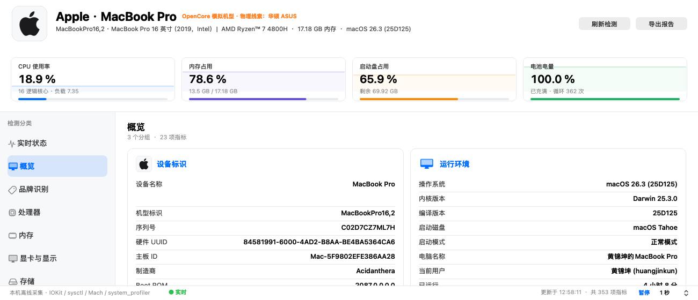
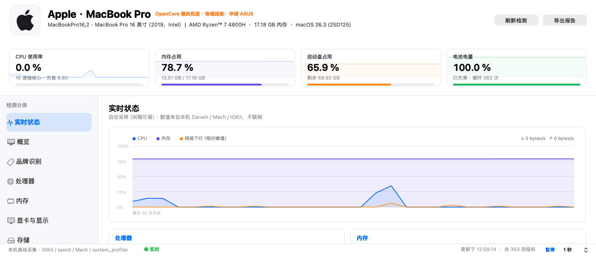
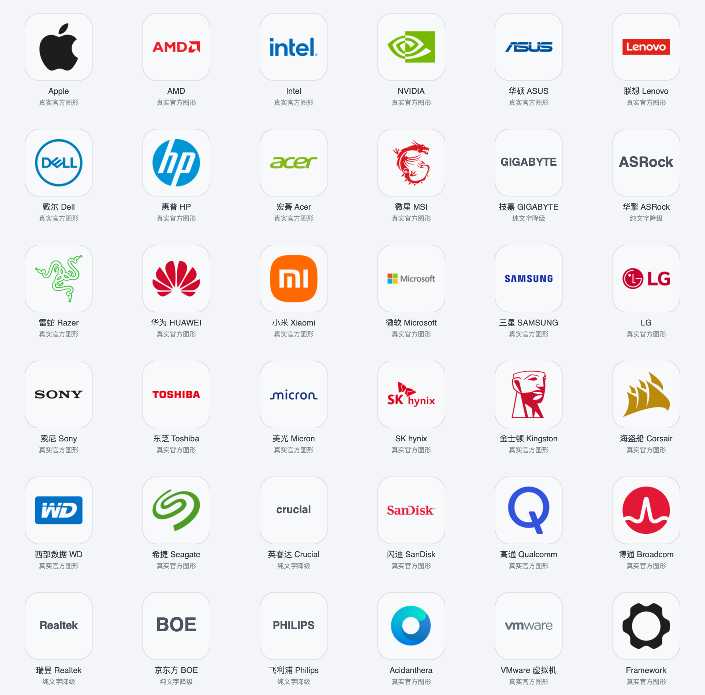

# Hardware Inspector · 硬件检测

一款用 Apple 原生框架（AppKit / IOKit / Darwin）为本机 macOS 编写的硬件检测工具：采集整机、CPU、GPU、内存、磁盘、电池、网络等信息，识别整机品牌与硬件品牌并展示**真实品牌 Logo**（非 AI 绘制），支持实时状态监控与多格式报告导出。

> 本机当前为 Hackintosh 环境（型号 `MacBookPro16,2`，AMD Ryzen + NVIDIA RTX），因此品牌识别会同时给出「机型品牌（Apple）」与「物理整机线索（如 ASUS）」两张结论，并标注置信度与证据链。

## 功能特性

- **概览 / 分类检测**：整机身份、处理器、显卡、内存、存储、电源电池、网络、操作系统等 10 个分类，逐项展示。
- **品牌识别**：解析 SMBIOS/DMI，识别机型品牌、引导固件（OpenCore 等）、物理整机与各大硬件品牌（AMD / NVIDIA / Micron / WD / ASUS / Apple …），并加载真实官方 / 开源品牌 SVG 转制的 PNG 徽标。
- **真实品牌 Logo**：构建期联网抓取真实素材，运行期离线使用；可在 `~/Library/Application Support/HardwareInspector/BrandLogos/` 放置 `<key>.png` 自定义覆盖。无真实素材的品牌仅显示文字，绝不 AI 绘制。
- **实时状态**：CPU / 内存 / 网络 / 磁盘 / 进程负载 / 热压力持续采样，含趋势曲线，支持暂停与 0.5/1/2/5 秒采样间隔（GUI 与 `--live` 命令行均支持）。
- **报告导出**：JSON、Markdown，以及命令行纯文本；含序列号 / UUID / MAC / IP（分享前请注意隐私）。

## 截图





## 系统要求

- macOS 12+（在 macOS 26 上构建验证）
- Xcode Command Line Tools（`xcode-select --install`）

## 构建

```bash
./build.sh            # 编译本机架构并打包 .app（已含 ad-hoc 签名）
./build.sh --universal   # 同时编译 x86_64 + arm64（耗时更久）
```

产物位于 `build/Hardware Inspector.app`，并生成 `build/Hardware-Inspector-<ver>.dmg` 安装镜像。

## 安装

打开 DMG，将 **Hardware Inspector** 拖入 `Applications` 即可。

> 说明：当前为 ad-hoc 签名，在其它 Mac 上首次打开可能触发「无法验证开发者」提示。如需无警告分发，需用 Developer ID 证书重新签名（`codesign --sign "Developer ID Application: ..."`）。

## 命令行用法

```bash
./HardwareInspector --cli                 # 纯文本报告
./HardwareInspector --json                # JSON 到 stdout
./HardwareInspector --md report.md        # 导出 Markdown
./HardwareInspector --json-file data.json # 导出 JSON 文件
./HardwareInspector --live                # 实时采样（终端）
./HardwareInspector --live --interval 2   # 每 2 秒
./HardwareInspector --live --json         # 实时 JSON Lines
./HardwareInspector --self-test           # 界面布局自检
```

## 隐私

所有采集与识别均在**本机完成**，不联网上报任何数据。报告中的序列号、UUID、MAC 地址、IP 等属于敏感信息，导出 / 分享前请自行脱敏。

## 下载

最新版 DMG 见 [GitHub Releases](https://github.com/huangjinkun2006/HardwareInspector/releases)。

## License

MIT
